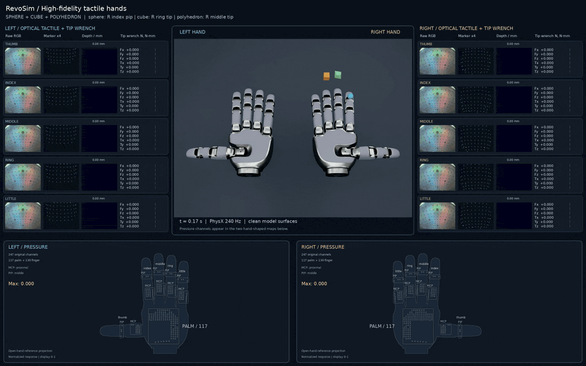

<h1 align="center">RevoSim: Scalable Multimodal Tactile Simulation for Dexterous Manipulation</h1>

<p align="center">
  <a href="https://davidlxu.github.io/RevoSim-web/">项目网站</a> ·
  <a href="README.md">English</a> ·
  <strong>中文</strong>
</p>

RevoSim 面向 real-to-sim-to-real，将视觉外观、关节运动学、动力学与多模态触觉集成在同一双手模型中。

<p align="center">
  <a href="docs/videos/revosim-orbit-60fps.mp4">
    
  </a>
</p>

每手有 21 个转动关节、247 个压阻通道和 5 个指尖视触觉区域。通过 Python API 或键盘控制物体，读取 RGB、Marker 位移、深度、六维接触合力和压阻响应。

<p align="center">
  <a href="docs/videos/revosim-demo-60fps.mp4">
    
  </a>
</p>

## 环境

目标环境是 **Linux、Python 3.11、Isaac Sim 5.1.0、Isaac Lab v2.3.2、CUDA PyTorch 2.7.0**。需要 Isaac Sim 支持的 NVIDIA RTX GPU 和驱动。运行验证使用 Ubuntu 24.04 / RTX 5090 32 GB。

创建环境并安装依赖：

```bash
conda create -n revosim python=3.11 -y
conda activate revosim
python -m pip install --upgrade pip
python -m pip install torch==2.7.0 torchvision==0.22.0 --index-url https://download.pytorch.org/whl/cu128
python -m pip install 'isaacsim[all,extscache]==5.1.0' --extra-index-url https://pypi.nvidia.com

git clone --branch v2.3.2 --depth 1 https://github.com/isaac-sim/IsaacLab.git ../IsaacLab
python -m pip install -e ../IsaacLab/source/isaaclab

# 在本仓库根目录执行。
python -m pip install -e .
python tools/doctor.py
```

已有兼容环境时，只需在仓库根目录执行 `python -m pip install -e .`。

安装参考：[Isaac Sim 5.1](https://docs.isaacsim.omniverse.nvidia.com/5.1.0/installation/install_python.html) · [Isaac Lab v2.3.2](https://isaac-sim.github.io/IsaacLab/v2.3.2/source/setup/installation/pip_installation.html)。

## 直接运行

```bash
# 读取传感器数据。
python examples/read_sensors.py --headless --device cuda:0

# 三物体触觉演示。
python examples/parallel_demo.py --headless --device cuda:0 --fps 60 --seed 42 --output outputs/parallel

# 逐个物体的长演示，包含跨掌抛跳。
python examples/slide_demo.py --headless --device cuda:0 --shape all --fps 30 --output outputs/demo

# 可视化交互：打开 Isaac Sim 和十指触觉面板。
python examples/interactive.py --device cuda:0 --shape sphere --output outputs/interactive

# 录制手指舞视频。
python examples/finger_dance.py --headless --device cuda:0 --output outputs/finger-dance
```

交互按键：`W/S` 前后、`A/D` 左右、`Q/E` 上下、空格释放、`R` 复位、`Esc` 退出。

## 面板与数据

输出目录包括：

| 文件 | 内容 |
|---|---|
| `dashboard.mp4` | 同步的双手与十指传感器面板 |
| `observations.h5` | 原始浮点 RGB、深度、Marker、压阻、六维力、姿态与时间戳，gzip 无损压缩 |
| `calibration.npz` | Marker 原始顺序、有效性掩码、相机坐标与配准资源 |
| `sensor_layout.json` | 运行时压阻点位、法线、所属 link，以及关节名称和角度范围 |
| `metadata.json` | 单位、坐标系、左右手/手指顺序及数据范围 |
| `frames.jsonl` | 每一帧的时间与演示阶段 |
| `physics.json` | 运行时添加的碰撞几何及质量补全记录 |
| `report.json` | 覆盖范围、各通道峰值和释放状态 |
| `telemetry.npz` | 并行演示逐帧的力、压阻、Marker、深度峰值、接触标志、物体姿态与光学目标编号 |

数组的第一维按 `left, right` 排列，第二维手指按 `thumb, index, middle, ring, little` 排列：

| 字段 | 单帧形状 | 语义 |
|---|---|---|
| `rgb` | `[2,5,3,240,320]` | 原始模拟视触觉 RGB，float32，范围 0–1 |
| `depth` | `[2,5,240,320]` | 接触压入深度，米 |
| `marker` | `[2,5,100,3]` | 指尖软垫 link 局部坐标的位移，米；需结合有效性掩码 |
| `wrench` | `[2,5,6]` | 指尖软垫与目标物体的接触合力与力矩，`Fx,Fy,Fz,Tx,Ty,Tz`，N / N·m |
| `contact` | `[2,5]` | 是否存在该指尖软垫与目标的法向接触 |
| `pressure` | `[2,247]` | 扩散后的非负归一化响应，可大于 1；不是 Pa、N 或电阻值 |
| `pad_pose` | `[2,5,7]` | 指尖软垫世界位置与 wxyz 四元数 |
| `joint_pos` | `[2,21]` | 实际关节角，弧度 |
| `object_pose` | `[7]` | 第一个目标物体世界位置与 wxyz 四元数 |
| `object_poses` | `[物体数,7]` | 所有目标物体的世界位姿 |
| `optical_object_index` | `[2,5]` | 多物体模式下，各指尖光学信号对应的物体编号；无压入时为 -1 |

六维合力仅包含 `DIP_rubber_link` 软垫与目标物体之间的法向力和摩擦力，不汇总近节、中节或硬壳上的接触。力矩参考点是 `DIP_rubber_link` 原点，结果也表达在这个局部坐标系中；面板为便于阅读把 N·m 转为 N·mm，原始数据始终保存 N·m。

压阻通道顺序：中指 MCP 23 / PIP 4，食指 23 / 4，无名指 23 / 4，小指 23 / 4，拇指 18 / 4，掌面 117。可通过 `revosim.resources.pressure_regions()` 获取切片。

## Python API

先启动 Isaac App，再创建 `World`：

```python
import argparse
from isaaclab.app import AppLauncher
from revosim.launch import configure

parser = argparse.ArgumentParser()
AppLauncher.add_app_launcher_args(parser)
app = AppLauncher(configure(parser.parse_args()), multi_gpu=False).app
try:
    from revosim.world import World
    world = World(shape="sphere", device="cuda:0")
    point, normal = world.surface_point("left", "index", "tip")
    world.reset_object(point + normal * 0.025)
    world.drive_object(point + normal * 0.005)
    for _ in range(120):
        world.step()               # 默认 4 个 240 Hz 物理步
        data = world.observe()
        print(data["wrench"][0, 1])
finally:
    app.close()
```

`world.sensor_layout()` 返回传感器点位、坐标系和关节顺序，可直接 JSON 序列化。

`world.set_joints(side, {joint_name: radians})` 设置关节目标，`world.release_object()` 释放物体。`World(shape=("sphere", "cube", "polyhedron"), hand_spacing=0.20)` 创建三物体场景，`drive_object(position, object_name="cube")` 控制指定物体。每个指尖的光学传感器同一时刻支持接触一个物体。

## 项目结构

```text
src/revosim/       World API、场景、面板、记录器、精简启动文件
  tactile/        压阻 / 深度 / HydroShear / Taxim 后端
  assets/         左右手 USD、PBR 贴图、触觉资源
examples/         数据读取、三物体演示、键盘交互
tools/           环境检查、数据验证和诊断
tests/           通道契约、坐标配准、六维合力及独立性测试
```

第三方许可和文件声明详见 `THIRD_PARTY_NOTICES.md` 及各资源目录。

## 引用

如需引用本项目，可使用以下 BibTeX：

```bibtex
@misc{zhang2026revosim,
  title = {{RevoSim}: Scalable Multimodal Tactile Simulation for Dexterous Manipulation},
  author = {Zhang, Ke and Xu, Lixin and Wang, Ziyi and Dong, Xiyue and Tan, Jie and Li, Chuanyu and Xu, Renjing},
  year = {2026},
  url = {https://davidlxu.github.io/RevoSim-web/}
}
```
